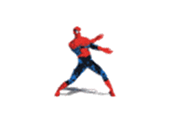

# Animated Sticker Widget for Übersicht

A lightweight, hardware-accelerated animated sticker widget for [Übersicht](https://tracesof.net/uebersicht/) on macOS, featuring transparent animated WebP graphics, refined edge snapping, interactive controls, and persistent settings.

Defaults to an iconic Spider-Man pixel-art walk cycle with ground shadow blending cleanly over any wallpaper.



---

## ✨ Features

- **Transparent Animated WebP**: Silky smooth animation with fractional alpha anti-aliasing and ground drop shadow that casts naturally onto any desktop background.
- **0% Idle CPU**: Pure hardware-accelerated image playback with `refreshFrequency: false` — no background polling or script execution.
- **Interactive Drag & Snapping**:
  - Smooth click & drag repositioning across the desktop.
  - **Refined Edge Snapping**: Snaps cleanly to macOS screen margins (15px horizontal, 14px vertical) with an edge release zone allowing placement directly against the bezel.
  - **Modifier Bypass**: Hold `Cmd`, `Option`, or `Shift` while dragging to bypass snapping entirely.
- **Double-Click Flip**: Double-click the sticker anytime to mirror direction (Face Left / Face Right).
- **Native macOS Menu (Above All Windows)**: Right-click to trigger a native macOS `NSMenu` rendered at `NSPopUpMenuWindowLevel`, guaranteed to float above all active application windows:
  - **Size**: Submenu with 50% (Mini), 75% (Compact), 100% (Normal), 125% (Large), 150% (Giant).
  - **Facing Direction**: ◀ Face Left / Face Right ▶.
  - **Play / Pause**: Freeze the animation on the current frame or resume playback.
  - **🎵 Sync with System Audio**: Automatically plays the animation whenever any audio is playing on the system (Spotify, Apple Music, YouTube, videos, games, podcasts) and freezes him in mid-stride when audio stops.
  - **Opacity**: 100%, 80%, 60%, 40% (Ghost mode).
  - **Ambient Shadow**: Toggle soft drop shadow on/off.
  - **Edge Snapping**: Toggle edge guidelines on or off.
  - **Reset Position**: Quick reset back to default desktop position.
- **Persistent State**: Position, size, orientation, play state, opacity, and preferences are automatically saved in `localStorage`.

---

## 🚀 Installation

1. Copy or clone the `sticker.widget` folder into your Übersicht widgets directory:
   ```bash
   cp -R sticker.widget "$HOME/Library/Application Support/Übersicht/widgets/"
   ```
2. Refresh Übersicht:
   ```bash
   osascript -e 'tell application id "tracesOf.Uebersicht" to refresh'
   ```

---

## 🎮 Controls

| Action | Result |
| :--- | :--- |
| **Click & Drag** | Move sticker across the screen (snaps to margins) |
| **Cmd / Option / Shift + Drag** | Free drag with snapping bypassed |
| **Double-Click** | Flip horizontal direction (Face Left / Face Right) |
| **Right-Click** | Open native macOS context menu (above all windows) |
| **Click Outside** | Dismiss context menu |

---

## 🎨 Using Custom Stickers

You can replace `sticker.widget/spiderman.webp` with any animated WebP or GIF of your choice:
1. Place your animated file into `sticker.widget/` (WebP recommended for smaller file size and transparent alpha).
2. If changing the filename or native dimensions, update `BASE_WIDTH` and `BASE_HEIGHT` in `index.jsx`.

---

## 📄 License

MIT License.
